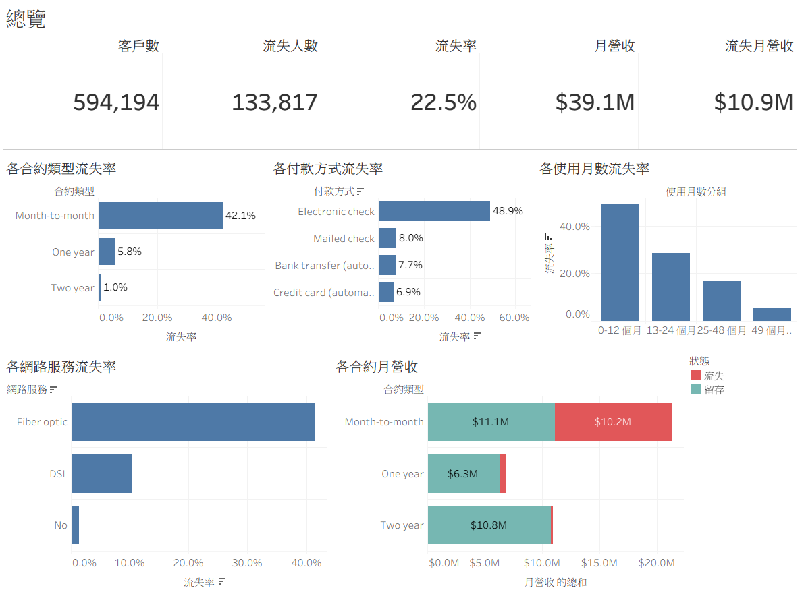

# 電信客戶流失預測與客群分析

## 30 秒看懂

| | |
|---|---|
| **問題** | 哪些客戶會流失？挽留資源該先花在誰身上？ |
| **資料** | [Kaggle Playground Series S6E3](https://www.kaggle.com/competitions/playground-series-s6e3) 電信客戶資料，59.4 萬列（合成資料），流失率 22.5% |
| **做了什麼** | EDA 與統計檢定 → LightGBM 預測每位客戶的流失機率 → KMeans 分成 4 個客群 → Streamlit App 即時預測單一客戶 → Tableau 總覽儀表板 |
| **結果** | 5 折交叉驗證 AUC **0.916 ± 0.001**；4 個客群的預測流失率和實際流失率差距都在 0.1 個百分點內；**高風險客只佔 28% 的客戶，卻佔 64% 的流失月營收** |



---

## 主要發現

### 流失因子

| 因子 | 流失率最高 | 流失率最低 | 效果量 |
|---|---|---|---|
| 付款方式 | 電子支票 48.9% | 信用卡自動扣款 6.9% | Cramér's V 0.48 |
| 合約類型 | 月租 42.1% | 兩年約 1.0% | Cramér's V 0.47 |
| 使用月數 | 0–12 個月 49.4% | 49 個月以上 5.3% | rank-biserial r 0.59 |
| 網路服務 | 光纖 41.5% | 無網路 1.4% | Cramér's V 0.43 |

- 樣本有 59 萬列，所有欄位的 p 值都小於 0.001，所以用效果量排序，不看 p 值。
- LightGBM 的 gain 重要度前三名也是付款方式（44%）、合約類型（17%）、使用月數（16%），跟統計檢定的結果一致。

### 四個客群

KMeans 用使用月數、月費、累計費用、加值服務數分群（先標準化）：

| 客群 | 客戶占比 | 平均使用月數 | 平均月費 | 實際流失率 | 模型預測 | 佔流失月營收 |
|---|---|---|---|---|---|---|
| 高風險客 | 28.5% | 19.6 | $82.8 | 46.8% | 46.7% | **64.3%** |
| 一般客 | 24.0% | 10.9 | $43.7 | 26.1% | 26.1% | 20.4% |
| 高價值客 | 29.7% | 62.5 | $92.2 | 9.2% | 9.2% | 15.0% |
| 超穩定低風險客 | 17.8% | 55.2 | $24.9 | 1.15% | 1.14% | 0.4% |

「模型預測」是 out-of-fold 機率的平均（每位客戶的機率都來自沒看過他的模型），所以這張表也是樣本外的校準檢查。

### 挽留建議

以下是根據資料提出、**還需要實驗驗證的假設**。上面的因子是相關，不是因果：讓客戶從電子支票改成自動扣款，不一定就會降低流失。

- **高風險客**：佔 64% 的流失月營收，優先處理。可以測試的做法：提供月租轉年約的折扣、推 OnlineSecurity、TechSupport 這類黏著型加值服務。
- **一般客**：平均只用了 11 個月，大多是新客。可以加強前 12 個月的新客體驗。
- **高價值客**：流失率不高，但平均月費最高，每流失一位的損失最大。重點是維持服務品質，不需要大規模促銷。
- **超穩定低風險客**：不需要主動挽留，資源留給前兩群。
- 驗證方式：在高風險客裡保留一組不做任何措施的對照組，比較兩組的流失率。

---

## 專案內容

```
                 churn_features.py（共用的特徵工程與編碼，所有程式都 import 它）

train.csv ─► train_and_save.py ─┬─► 模型檔（LightGBM、KMeans）─► app.py（Streamlit 即時預測）
                                └─► oof_predictions.csv（交叉驗證的流失機率）
                                          │
                                          ▼
                                 export_for_tableau.py ─► tableau/*.csv ─► Tableau 總覽儀表板
```

| 檔案 | 用途 |
|------|------|
| `churn_da_ds.ipynb` / `.html` | 分析筆記：EDA、統計顯著性檢定、洩漏檢查、多模型比較、分群演算法比較（KMeans、DBSCAN、HDBSCAN、GMM 等） |
| `churn_features.py` | 共用模組：特徵工程、one-hot 編碼（固定類別清單）、載入模型、評分 |
| `train_and_save.py` | 5 折交叉驗證、用全部資料訓練最終 LightGBM、KMeans 分群，輸出模型檔與 `oof_predictions.csv` |
| `app.py` | Streamlit App：輸入一位客戶的資料，回傳流失機率、所屬客群和挽留建議 |
| `export_for_tableau.py` | 輸出 Tableau 用的客戶明細 `churn_dashboard.csv`、特徵重要度、資料品質檢核表 |
| `tableau/overview.png` | Tableau 總覽儀表板截圖 |
| `tests/` | 回歸測試：一位客戶和一整批的編碼、預測必須一致，沒看過的類別要報錯；Tableau 匯出的十分位、風險分級、挽留名單、特徵重要度 |
| `model_lgbm.joblib` / `kmeans.joblib` / `seg_scaler.joblib` | 最終模型、分群器和分群前的標準化器 |
| `meta.json` / `feature_choices.json` | 特徵順序、客群標籤、交叉驗證指標；各類別欄的固定類別清單（也是 App 的下拉選單） |
| `Dockerfile` / `railway.json` | 部署設定 |

### Tableau 總覽儀表板

一頁總覽：KPI 橫幅（客戶數、流失人數、流失率、月營收、流失月營收），合約類型、付款方式、使用月數、網路服務四張流失率圖，以及各合約類型的月營收（流失 vs 留存）。

所有圖表都接同一份每位客戶一列的明細（`churn_dashboard.csv`），指標在 Tableau 裡彙總，不另外準備預先彙總好的表。

---

## 本機執行

```bash
uv sync

# 訓練模型（需要 train.csv 在同目錄）：產生模型檔與 oof_predictions.csv
uv run train_and_save.py

# 測試
uv run --with pytest python -m pytest -q

# 啟動預測 App，打開 http://localhost:8501
uv run streamlit run app.py

# 產生 Tableau 用的 CSV（放在 tableau/）
uv run export_for_tableau.py
```

---

## 部署（Railway）

Streamlit App 曾部署在 Railway（目前沒有公開網址），步驟：

1. 把 repo 推上 GitHub。
2. Railway → New Project → Deploy from GitHub repo，選此 repo。
3. Railway 會讀 `Dockerfile` 建置；`$PORT` 已在 Dockerfile 處理，不用另外設定。
4. 部署完成後在 Settings → Networking 產生公開網址。

---

## 設計決策

- **不平衡資料的指標**：流失率 22.5%，用 AUC / PR-AUC 而不是 accuracy（全部猜「不流失」也有 77.5% accuracy，但一個流失客都抓不到）。
- **沒有資料洩漏**：單欄 AUC 最高只有 0.79（tenure），拔掉後整體 AUC 幾乎不變，表示模型是靠多個訊號疊加，不是單一欄位作弊。
- **模型選擇**：GradientBoosting、HistGB、LightGBM 的 AUC 都是 0.916（Logistic Regression 0.912），差距在交叉驗證的標準差內。選 LightGBM 是因為在這個資料量下訓練較快、較省記憶體，不是因為效能顯著較好。
- **評估和最終模型分開**：用 5 折交叉驗證報告分數，再用全部資料訓練最終模型。Tableau 上的流失機率用 out-of-fold 機率，所以「預測 vs 實際」的比較是樣本外的。
- **訓練和預測只有一套處理**：特徵工程與編碼集中在 `churn_features.py`。one-hot 用訓練時的固定類別清單，一位客戶和一整批編出來的欄位完全相同；遇到沒看過的類別直接報錯。`tests/` 鎖住這個行為。
- **缺值規則**：TotalCharges 缺值時用「使用月數 × 月費」補（資料中兩者的中位數比值為 1.00、相關係數 0.99）；剛加入的客戶補出來是 0，而不是全體中位數。
- **看排序，不看單一機率**：合成資料的個體機率不會很高，重點是相對排序（AUC 評估的就是排序能力）和群層級的校準。
- **分群前標準化**：KMeans 靠距離，不標準化的話 TotalCharges 佔總變異的 99.97%，分群會退化成只切 TotalCharges。

---

*資料為 Kaggle 合成資料，僅供技能展示；數字不代表真實客戶行為。*
